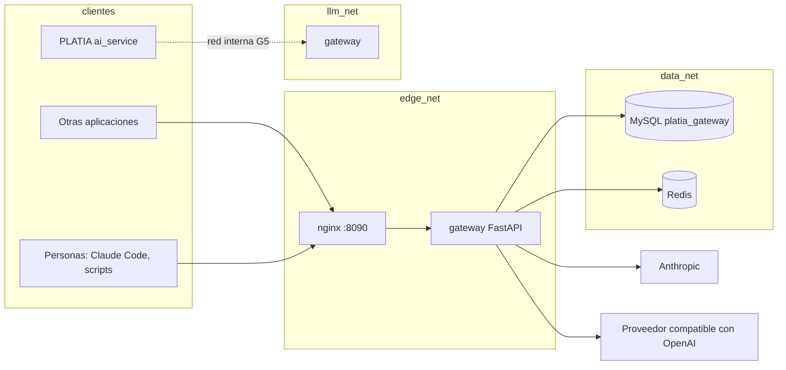
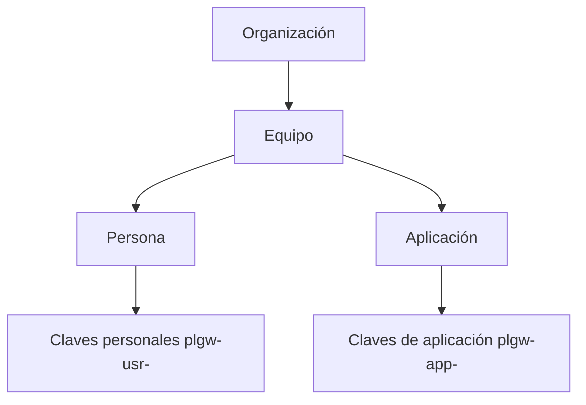
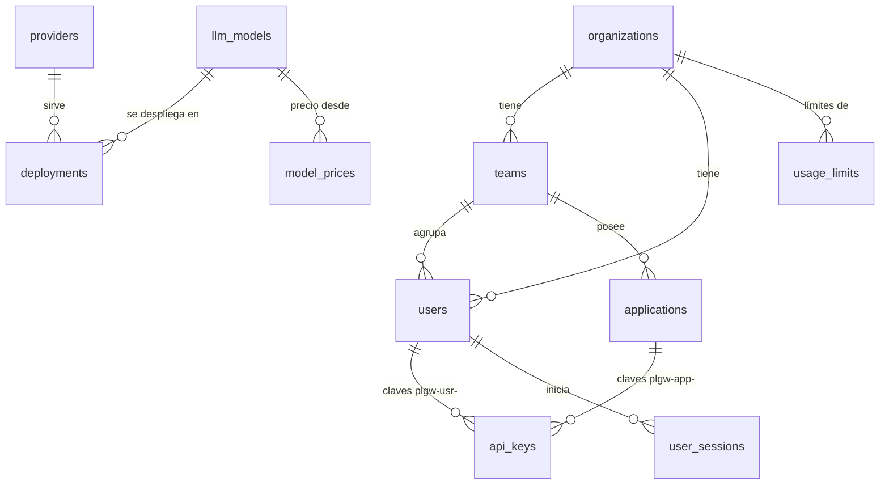

# Arquitectura

El gateway es un servicio FastAPI asíncrono detrás de Nginx, con MySQL para la
configuración y la auditoría y Redis para lo que cambia en cada petición (cuotas, límites,
salud de despliegues). Por dentro, cada petición recorre un **pipeline de etapas** que leen
y escriben un contexto compartido (libro, cap. 1 y 3). Las razones de cada elección están
en [`adr/`](adr/).

## Contenedores y redes

- **edge_net**: Nginx y el gateway. Nginx es el único con puerto publicado.
- **data_net**: el gateway, MySQL y Redis. Ninguno de los dos publica puertos.
- **llm_net** (G5): red Docker compartida con PLATIA para que `ai_service` llame al
  gateway sin salir del servidor. La crea el `docker-compose.yml` del gateway con el nombre
  fijo `platia_llm_net` (alias del gateway: `platia-gateway`); PLATIA la declara externa en
  su `docker-compose.gateway.yml` y solo une `ai_service` ([ADR-009](adr/ADR-009-conexion-platia.md)).

## Contratos de entrada

| Ruta | Contrato | Para quién | Fase |
| --- | --- | --- | --- |
| `POST /v1/messages` | Anthropic Messages | PLATIA y clientes del SDK de Anthropic | G3 (G4 streaming) |
| `POST /v1/chat/completions` | OpenAI Chat Completions | Clientes compatibles con OpenAI | G3 (G4 streaming) |
| `GET /v1/models` | OpenAI | Saber qué modelos puede usar una clave | G3 |
| `GET /health` | Propio | Nginx y monitorización | G0 |
| `/auth/*` y `/me/*` | Propio (JSON) | Personas: sesión, MFA y claves personales; el panel y el portal | G10 |

Los dos contratos convergen en el mismo pipeline: la diferencia está solo en cómo se lee la
entrada y cómo se da forma a la salida. Cuando la petición y el proveedor son de la misma
familia (Anthropic → Anthropic), el cuerpo original viaja casi intacto después de los
controles, para no perder funciones que una traducción rompería
([ADR-002](adr/ADR-002-doble-contrato.md)).

**Cabeceras propias** (nunca se reenvían al proveedor):

| Cabecera | Para qué | Quién puede enviarla |
| --- | --- | --- |
| `Authorization: Bearer plgw-…` o `x-api-key: plgw-…` | Clave de aplicación o personal | Todos |
| `X-Platia-User-Id` | Persona final de la aplicación | Solo aplicaciones marcadas como de confianza |
| `X-Platia-Purpose` | Tarea o propósito (por ejemplo `proposal_writer`), para cuotas, routing y auditoría | Todos; se valida contra la lista de la aplicación |
| `X-Request-ID` | Correlación de extremo a extremo; si falta, la pone Nginx | Todos |

**Cabeceras de respuesta**: `X-Request-ID`, `X-Platia-Model-Used`, `X-Platia-Cost-Usd`,
`X-Platia-Latency-Ms` (G3 y G7).

## El pipeline

Cada etapa recibe el contexto de la petición, lo lee, escribe su resultado y devuelve. Una
etapa no llama a otra: así cada una se prueba sola y el orden se puede cambiar. El libro
describe 14 etapas; este gateway empieza con 8 y las demás se añaden si hacen falta
([ADR-003](adr/ADR-003-pipeline-de-etapas.md)).

| # | Etapa | Qué resuelve | Si falla su dependencia | Fase |
| --- | --- | --- | --- | --- |
| 1 | `auth` | Clave → aplicación o persona → equipo → organización activa; persona y propósito declarados | Se rechaza (401) | G3 |
| 2 | `security_input` | Jailbreak, marcas de clasificación, secretos | Sin la política, se rechaza (503); nunca se salta | G8 |
| 3 | `filter` | Datos personales: detectar y tachar según la política | Se rechaza (503) | G8 |
| 4 | `policy` | Modelo final permitido para esa clave y propósito | Se rechaza (403 o 404) | G3 |
| 4a | `cache` | Respuesta guardada para la misma petición, aplicación y persona (si la aplicación la activa) | Se sigue sin caché | G11 |
| 4b | `quota` | Cuotas de gasto, peticiones y tokens por periodo; límites por minuto y de simultáneas | Con límites y sin Redis, se rechaza (503); si no, 402 o 429 | G7 |
| 5 | `route` | Despliegue y adaptador del proveedor | Se rechaza (503) | G3, G6 |
| 6 | `execute` | Llamada al proveedor con tiempo máximo y cadena de reserva | Siguiente de la cadena; si no queda, 502 | G3, G6 |
| 7 | `security_output` | Filtro de salida, también por trozos en streaming | Se corta la respuesta | G8 |
| 8 | `audit` | Registro con huellas, coste y cabeceras; después se sella en cadena | Sin apertura, se rechaza; el cierre se concilia | G3, G9 |

Atajos: una etapa puede cortar el pipeline (identidad inválida, bloqueo de seguridad, cuota
agotada). La auditoría se ejecuta siempre, también en los cortes y cuando el cliente se
desconecta a mitad de un streaming (bloque `finally`). Un acierto de la caché salta `quota`,
`route` y `execute`, pero pasa por `security_output` y `audit`
([ADR-015](adr/ADR-015-cache-exacta.md)).

**Telemetría** (G12, [ADR-016](adr/ADR-016-telemetria.md)): no es una etapa. Al terminar cada
petición, también en streaming y en errores, `telemetry.finish` registra las métricas de
Prometheus y publica un resumen en tiempo real. Si la seguridad de contenido la bloqueó, emite
`security.blocked`. `quota` emite `quota.alert` y `quota.exhausted`, y `execute`,
`deployment.cooled`. Los eventos van a Redis (WebSocket `/events/stream`) y a una cola de
entregas en MySQL que un bucle en segundo plano envía, firmadas, a los webhooks. El tiempo
propio del gateway (sin el proveedor) se guarda en `audit_logs.overhead_ms` para medir RNF-06.

**En el código** (G3, [ADR-007](adr/ADR-007-contrato-y-pipeline-minimo.md)): cada etapa es
un módulo de `gateway/app/pipeline/` y `runner.py` fija el orden: `auth` → `policy` →
`security_input` y `filter` (G8) → `policy` → `cache` (G11) → `quota` (G7) → `route` → apertura de `audit` →
`execute` → `security_output` (G8) → cierre de `audit` y ajuste de `quota`. Los contratos y su
traducción están en `contracts.py`, los adaptadores en `providers.py` y las rutas en
`api.py`. Los 401 no se registran en `audit_logs` (solo en el log), para que una clave
falsa no pueda escribir en la base.

**Streaming** (G4, [ADR-008](adr/ADR-008-streaming.md)): con `stream: true`, `execute` abre
la respuesta del proveedor y comprueba su código. Desde ahí, `streaming.py` reenvía los
eventos SSE tal cual entre familias iguales, o traducidos si son de familias distintas
(solo texto). También lee el uso de tokens y cierra la auditoría en el `finally` del
generador, aunque el cliente se desconecte.

**Reserva** (G6, [ADR-010](adr/ADR-010-reserva-y-enfriamiento.md)): `route` deja una lista
ordenada de destinos: los despliegues del modelo pedido (por prioridad y peso) y después los
de su cadena de reserva que la aplicación tenga permitidos. `execute` la recorre mientras
el fallo sea del destino (429, 5xx, sin respuesta) y no de la petición (400). Los
despliegues que fallan se enfrían en Redis (`cooldown.py`) y pasan al final de la lista.
La auditoría guarda los intentos y el destino que respondió.

**Cuotas y límites** (G7, [ADR-011](adr/ADR-011-cuotas-y-limites.md)): `quota` reúne los
límites de `usage_limits` que tocan a la petición (organización, equipo, aplicación y
persona) y, con un guion Lua, comprueba y sube a la vez sus contadores en Redis. Gasto,
peticiones o tokens de día o de mes agotados: 402; por minuto o simultáneas: 429. Al
terminar, `quota.settle` suma el coste y los tokens reales y libera la simultánea. Los
contadores de día y de mes se reconstruyen desde la auditoría si faltan.

**Seguridad de contenido** (G8, [ADR-012](adr/ADR-012-seguridad-de-contenido.md)):
`security_input` y `filter` buscan en el texto de la petición manipulación, marcas de
clasificación, secretos y datos personales (`content.py`) y aplican la política de
`content_policies`: bloquear, tachar o anotar. `security_output` hace lo mismo con la
respuesta y, en streaming, `streaming.OutputFilter` lo hace por trozos. Lo encontrado va a
`audit_logs.security_flags`, sin el texto.

**Auditoría verificable** (G9, [ADR-013](adr/ADR-013-auditoria-verificable.md)): la
apertura guarda la huella del prompt y de la persona (HMAC con la sal de la organización).
Un proceso en segundo plano (`audit_chain.py`) sella por orden las filas cerradas con una
cadena SHA-256 y concilia las que se quedaron pendientes. Unos disparadores de MySQL
impiden cambiar o borrar una fila sellada, salvo seudonimizar a la persona.
`cli audit-verify` recalcula la cadena.

**Etapas del libro que no entran ahora**: ganchos corporativos antes y después del chat
(los webhooks de G12 solo avisan, no deciden), caché semántica (G11, ADR-015), contexto RAG (PLATIA
ya lo tiene), recorte del historial y control previo de ventana (descartados en G7: el proveedor ya rechaza
lo que no cabe, con un 400 que el gateway devuelve tal cual).

## Identidad

- Una **aplicación** pertenece a un equipo y tiene su propio presupuesto, su lista de
  propósitos permitidos y, si se quiere, una lista cerrada de modelos. Estados: activa,
  suspendida (reversible) y revocada (definitiva).
- Las claves son opacas, con prefijo visible y secreto aleatorio; se guarda solo su hash.
  Una aplicación puede tener una clave secundaria con caducidad para rotar sin cortes.
- Las claves de aplicación y las personales no se confunden: un tipo no puede hacerse pasar
  por el otro.
- Solo una aplicación **de confianza** (PLATIA) puede declarar la persona final con
  `X-Platia-User-Id`. El gateway no conoce las cuentas de PLATIA: guarda ese id como dato
  de atribución, no como identidad autenticada.
- Políticas en cascada (persona → equipo → organización): se toma el valor más específico
  configurado; si una política exige un techo del nivel superior, se comprueba aparte.
- Sin dispositivos ni device binding en este alcance ([ADR-004](adr/ADR-004-identidad.md)).
- Las **personas** entran en el panel y el portal con contraseña y TOTP; la sesión se
  comprueba en MySQL en cada petición, así que revocarla surte efecto al momento. Sus
  **claves personales** siguen las reglas de la aplicación de la organización marcada para
  ellas, y la persona queda como persona final de cada llamada
  ([ADR-014](adr/ADR-014-identidad-de-personas.md)).

## Reparto con PLATIA

PLATIA sigue gobernando lo que es de su negocio y el gateway lo que es corporativo
([ADR-001](adr/ADR-001-servicio-aparte.md)):

| Responsabilidad | PLATIA | Gateway |
| --- | --- | --- |
| Prompts versionados y modelo por tarea | Sí | No |
| Presupuesto por tarea y por persona de PLATIA, ROI | Sí | No |
| Cuota por organización, equipo, aplicación y persona | No | Sí |
| Guardarraíles de negocio | Sí | No |
| Jailbreak, datos personales, secretos y filtro de salida corporativos | No | Sí |
| Embeddings, Qdrant y RAG con permisos | Sí | No |
| Reserva entre proveedores y salud de despliegues | Su cadena actual, como respaldo | Sí |
| Registro de cada llamada | `llm_usage_log` | Auditoría encadenada |

`ai_service` llama siempre en streaming (`messages.stream`), así que PLATIA solo puede
pasar por el gateway cuando G4 esté hecho. En G5 se cambian solo la URL base y la clave del
SDK de Anthropic, detrás de `LLM_GATEWAY_ENABLED`. Si el gateway no responde, por defecto
se falla cerrado; volver a la llamada directa es una decisión manual.

Cada llamada de PLATIA lleva su tarea (`X-Platia-Purpose`), la persona
(`X-Platia-User-Id`) y su `correlation_id` como `X-Request-ID`, así que una fila de
`llm_usage_log` y una de `audit_logs` se cruzan por ese id. Puesta en marcha, comparación de
costes y vuelta atrás: [conexion-platia.md](conexion-platia.md).

## Datos

MySQL guarda la configuración y la auditoría; Redis, los contadores de cuota y de límites,
el estado de salud y enfriamiento de los despliegues y la revocación de claves. Las tablas
se crean con migraciones Alembic ([ADR-006](adr/ADR-006-modelo-de-datos.md)).

| Tabla | Qué guarda | Fase en que se usa |
| --- | --- | --- |
| `organizations`, `teams`, `users` | Jerarquía de identidad; sal de auditoría por organización; contraseña y MFA de cada persona | G3, G10 |
| `user_sessions` | Sesiones de las personas: hash de la renovación, caducidad y revocación | G10 |
| `applications` | Clientes registrados: estado, confianza, propósitos y modelos permitidos; la de las claves personales; su caché | G3, G10, G11 |
| `api_keys` | Hash y prefijo de cada clave, caducidad y revocación | G3 |
| `providers` | Cuentas de proveedor con la clave cifrada (AES-256-GCM) | G3 |
| `llm_models`, `deployments` | Modelos, sus funciones y dónde se sirven, con peso y prioridad | G3, G6 |
| `model_prices` | USD por millón de tokens desde una fecha, incluida la caché | G3, G7 |
| `usage_limits` | Cuotas y límites de ritmo por ámbito, métrica y periodo | G7 |
| `content_policies` | Acción por categoría de contenido, sentido y organización o aplicación | G8 |
| `audit_logs` | Una fila por petición: quién, qué, resultado, tokens, coste, hashes | G3, G9 |
| `audit_chain_state` | Último eslabón sellado de la cadena de la auditoría | G9 |
| `webhooks`, `webhook_deliveries` | Destinos de los avisos (secreto cifrado, eventos, estado) y cola de entregas con sus reintentos | G12 |

`audit_logs` no tiene claves foráneas, para sobrevivir a cambios en la configuración.

El texto de prompts y respuestas no se guarda en claro: la auditoría guarda hashes (con sal
por organización), tokens, coste, latencia, modelo y decisiones de seguridad (G9).
