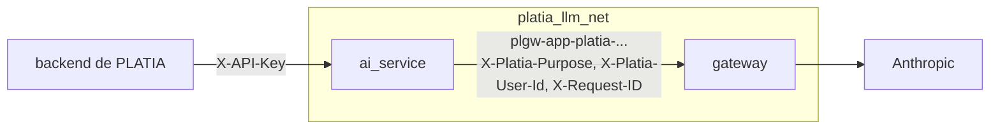

# Conexión con PLATIA

Cómo hacer que PLATIA llame a Claude a través del gateway, cómo comprobarlo y cómo volver
atrás. Decisiones en [ADR-009](adr/ADR-009-conexion-platia.md) y en el ADR-019 de PLATIA.



## 1. Dar de alta PLATIA en el gateway

Con el gateway levantado (`docker compose up -d --build --wait`) y la clave de Anthropic
exportada solo en la terminal:

```bash
export ANTHROPIC_API_KEY=sk-ant-...
bash scripts/alta_platia.sh
```

Crea, si no existen, la organización `cotecnia`, el equipo `plataforma`, la aplicación
`platia` (de confianza, cualquier tarea), el proveedor `anthropic` con la clave cifrada y
los modelos `claude-opus-5-5`, `claude-sonnet-5-5` y `claude-haiku-5-5` con los precios de
PLATIA. Al final muestra una clave `plgw-app-platia-...` que no se vuelve a ver. Repetirlo
no cambia lo que ya hay; solo crea otra clave (las anteriores se revocan con
`cli revoke-key --prefix ...`).

Si PLATIA usa otros modelos (Administración > Modelos y costes), hay que darlos de alta también:
`cli create-model`, `cli create-deployment` y `cli set-price`, con el mismo nombre que en
PLATIA.

## 2. Encender el interruptor en PLATIA

En el `.env` de PLATIA:

```bash
LLM_GATEWAY_ENABLED=true
LLM_GATEWAY_API_KEY=plgw-app-platia-...
```

y levantarla con la red del gateway:

```bash
docker compose -f docker-compose.yml -f docker-compose.gateway.yml up -d
```

(En producción se añade `-f docker-compose.prod.yml`; `deploy.sh` y `restore.sh` de PLATIA
añaden solos el fichero de la red cuando el interruptor está encendido.)

Comprobación: el `/health` del servicio de IA de PLATIA devuelve `"llm_gateway": true` y
`checks.llm_gateway: configured`, y cada uso de la IA aparece en el gateway:

```bash
docker compose run --rm migrations python -m app.cli usage --app platia --since 2026-11-01
```

## 3. Comparar costes

Cada llamada queda en dos registros con el mismo identificador: `llm_usage_log` de PLATIA
(por tarea y negocio) y `audit_logs` del gateway (por aplicación, persona y proveedor). El
`correlation_id` de PLATIA es el `request_id` del gateway.

- Una tarea: el `correlation_id` de su fila en PLATIA (`GET /api/admin/ai/usage`, que
  también filtra por él) y `cli usage --request-id <correlation_id>` en el gateway. Los
  tokens deben coincidir.
- Un periodo: `GET /api/admin/ai/usage/summary?days=30` de PLATIA, por tarea y modelo como
  `cli usage`, frente a `cli usage --app platia --since <hace 30 días>`. Los dos dan el
  coste en USD; PLATIA lo enseña en pantalla en euros (`AI_USD_EUR_RATE`).

Si los tokens coinciden y el coste no, los precios de las dos tablas no son iguales:
actualiza el del gateway con `cli set-price ... --since <fecha>` (los precios tienen
fecha de entrada en vigor; no se reescribe el pasado).

La auditoría del gateway nunca guarda el texto de los prompts ni de las respuestas.

## 4. Volver atrás

En el `.env` de PLATIA, `LLM_GATEWAY_ENABLED=false` y la `ANTHROPIC_API_KEY` puesta, y
rearrancar `ai_service`. No hace falta desplegar código. Mientras el interruptor está
encendido no hay salto automático a la llamada directa: si el gateway cae, la IA de PLATIA
no responde hasta que vuelva (fallar cerrado).

## 5. Prueba en Docker sin coste

```bash
PLATIA_DIR=../platia-dev bash scripts/prueba_platia.sh
```

Construye el `ai_service` de PLATIA (o usa la imagen de `AI_IMAGE`), lo arranca en
`platia_llm_net` con un proveedor simulado y comprueba: `/v1/complete` y `/v1/stream` por el
gateway, la tarea, la persona, el `correlation_id`, los tokens y el coste en la auditoría,
y la vuelta atrás con el interruptor apagado. Usa nombres nuevos en cada ejecución: no
toca la configuración real.
